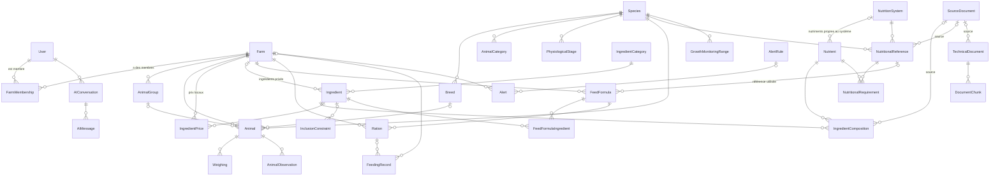

# Schéma de la base de données

PostgreSQL 18 · 12 applications Django · migrations réversibles.
Toutes les tables métier possèdent `created_at` / `updated_at` (sauf les historiques, qui n'ont qu'une date de création).

## 1. Vue d'ensemble

`ValidationRecord`, `ActivityLog` et `Alert` utilisent une clé générique (`content_type` + `object_id`)
pour pointer vers n'importe quelle donnée.

## 2. Applications et tables

| Application | Modèles | Rôle |
|---|---|---|
| `accounts` | User | Comptes (e-mail, rôle ADMIN / ELEVEUR / EXPERT) |
| `governance` | SourceDocument, ValidationRecord, ImportBatch, ActivityLog | Sources, historique des validations, imports, journal |
| `farms` | Farm, FarmMembership | Exploitations et droits d'accès (OWNER, MANAGER, EXPERT en lecture seule) |
| `animals` | Species, Breed, AnimalCategory, PhysiologicalStage, ProductionObjective, AnimalGroup, Animal, AnimalObservation | Animaux et nomenclatures par espèce |
| `nutrition` | NutritionSystem, Nutrient, IngredientCategory, Ingredient, IngredientComposition, IngredientPrice, NutritionalReference, NutritionalRequirement, InclusionConstraint | Référentiel nutritionnel |
| `formulations` | FeedFormula, FeedFormulaIngredient | Formules calculées ou saisies |
| `feeding` | Ration, FeedingRecord | Rations en cours et distributions |
| `growth` | Weighing, GrowthMonitoringRange | Pesées et plages de suivi de GMD |
| `alerts` | AlertRule, Alert | Alertes et rappels explicables |
| `knowledge_base` | TechnicalDocument, DocumentChunk | Documents RAG, passages, embeddings |
| `assistant` | AIConversation, AIMessage | Historique des conversations |

Les noms d'entités demandés par le cahier des charges sont tous présents. `Ration`, `AnimalCategory`,
`PhysiologicalStage`, `ProductionObjective`, `NutritionSystem`, `Nutrient`, `InclusionConstraint`,
`GrowthMonitoringRange`, `AlertRule`, `SourceDocument`, `ImportBatch` et `ActivityLog` ont été ajoutés
pour répondre aux modules fonctionnels (rations en cours, systèmes nutritionnels, plages de suivi, traçabilité).

## 3. Données de référence et validation

Les modèles suivants héritent de `ValidatedReferenceModel` :
`Ingredient`, `IngredientComposition`, `NutritionalReference`, `InclusionConstraint`,
`GrowthMonitoringRange`, `TechnicalDocument`.

Champs communs : `source`, `reference_date`, `status` (DRAFT, PENDING, VALIDATED, REJECTED), `is_demo`,
`validated_by`, `validated_at`, `validation_comment`, `created_by`.

Contraintes PostgreSQL appliquées à chacun :

| Contrainte | Effet |
|---|---|
| `*_demo_never_validated` | Une donnée DEMO ne peut jamais passer au statut VALIDÉ |
| `*_validated_has_source` | Une donnée validée est obligatoirement rattachée à une source |
| `*_validated_has_date` | Une donnée validée porte sa date de validation |

Le moteur nutritionnel n'utilisera que `objects.usable_for_engine()`, c'est-à-dire les données VALIDÉES et non DEMO.

## 4. Systèmes nutritionnels, unités et matière sèche

- `Nutrient` fixe le **code**, l'**unité de quantité** (g, mg, UFL, UFV, Mcal, MJ), la **base** (par kg MS ou par kg brut)
  et le **système** (INRA, NRC… ou vide pour un nutriment universel).
- Compositions et besoins pointent vers un `Nutrient` : deux valeurs ne sont comparables que si elles
  portent sur le même nutriment, donc la même unité et le même système.
- Un besoin (`NutritionalRequirement`) ne peut utiliser qu'un nutriment universel ou un nutriment du système de sa référence.
- Seule la matière sèche (`MS`) s'exprime en g/kg de produit brut ; tout le reste s'exprime par kg de MS
  (contraintes `nutrient_dry_matter_in_g_per_kg_as_fed` et `nutrient_only_dry_matter_on_as_fed_basis`).
- Les conversions brut ↔ MS sont dans `nutrition/units.py` ; une MS inconnue lève une erreur, elle n'est jamais supposée.
- Les prix sont saisis par kg **brut** (`price_per_kg_as_fed`) ; le moteur les convertit en prix par kg de MS.
- Une composition absente signifie « inconnue » (jamais zéro). Une seule valeur VALIDÉE par couple
  ingrédient / nutriment (`composition_single_validated_value`).

## 5. Isolation des données

- Toute donnée d'élevage est rattachée, directement ou par l'animal, à une `Farm`.
- `Farm.objects.accessible_by(user)` : exploitations dont l'utilisateur est membre actif ; toutes pour un administrateur.
- Un expert n'accède qu'aux exploitations qui l'ont invité (rôle `EXPERT`, lecture seule).
- Un ingrédient peut être privé (`Ingredient.farm`) : il n'est alors visible que par son exploitation.
- Les conversations IA sont privées à leur utilisateur.

## 6. Autres contraintes notables

| Table | Contraintes |
|---|---|
| Animal | numéro unique par exploitation ; poids initial > 0 ; race, catégorie, stade et lot cohérents avec l'espèce et l'exploitation (validation applicative) |
| Weighing | une pesée par animal et par jour ; poids > 0 ; pas de date future ni antérieure à la naissance |
| NutritionalRequirement | au moins une valeur ; valeurs ≥ 0 ; min ≤ cible ≤ max ; unique par référence / nutriment / expression |
| NutritionalReference | plages d'âge, de poids et d'ingestion ordonnées et positives |
| IngredientPrice | prix > 0 ; quantité disponible ≥ 0 |
| InclusionConstraint | cible = un ingrédient OU une catégorie ; bornes entre 0 et 100 % ; min ≤ max |
| FeedFormula | une formule DEMO n'est jamais validée ; validée ⇒ date de validation |
| FeedFormulaIngredient | pourcentages entre 0 et 100 ; quantités ≥ 0 ; un ingrédient une seule fois |
| Ration / FeedingRecord | cible = un animal OU un lot ; quantités ≥ 0 ; consommé ≤ distribué ; refus ≤ distribué |
| Alert | rattachée à une exploitation ou à un destinataire ; pas de doublon d'alerte ouverte pour la même cause |
| DocumentChunk | rang unique par document ; index GIN plein texte |
| FarmMembership | un seul propriétaire par exploitation ; un utilisateur au plus une fois par exploitation |

## 7. Données initiales (migrations de données)

Uniquement des **nomenclatures**, aucune valeur nutritionnelle :

- Espèces : Ovin (active), Caprin et Bovin (créées, inactives).
- Races ovines : Peul-Peul, Touabire, Ladoum, Djallonké, Waralé.
- 6 catégories ovines, 7 stades physiologiques, 6 objectifs de production.
- 8 catégories d'ingrédients.
- Nutriments universels : MS, MAT, MG, MM, CB, NDF, ADF, Ca, P.
- Systèmes INRA (UFL, UFV, PDI) et NRC (EM, PM) : définitions à faire vérifier par un expert.

Tout est modifiable dans l'administration.
